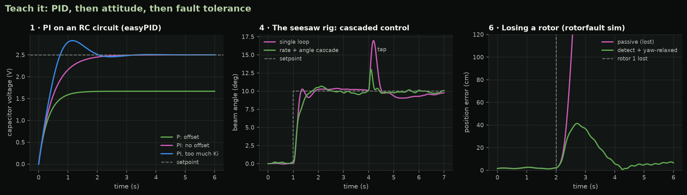
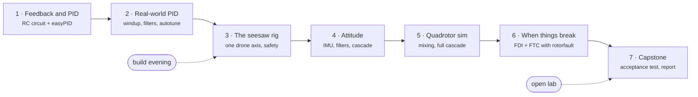

# Teach it: a drone-control bootcamp at Space²

**PID, then attitude, then fault tolerance** -- a seven-evening curriculum that takes
engineering students from a resistor and a capacitor to a quadrotor that survives losing
a rotor. It is taught with two of Rami Kronbi's own projects: the
[easyPID](https://github.com/Kronbii/easyPID) Arduino library and the
[rotorfault](https://github.com/Kronbii/rotor-fault-recovery) rotor-fault simulation study.
Designed for 2nd-4th year engineering students at Space², a Lebanese innovation space for
university students.

> **Status: designed, not yet taught.** Everything here is ready to run with a first
> cohort and the software is tested, but no student has taken the course and no rig has
> been built from these documents yet. The [pilot plan](cohort/pilot-plan.md) says what the
> first cohort will measure; until then this repository claims no learning outcomes.



*Generated by [`tools/hero_figure.py`](tools/hero_figure.py) from the same code as the
notebooks: (1) P and PI on the lab-1 RC circuit with the easyPID port, (2) a single loop
versus a rate/angle cascade rejecting a tap on the rig model, (3) a complete loss of rotor 1
in the rotorfault simulator, passive controller versus the fault-tolerant pipeline.
All simulation, with assumed parameters.*

## Who it is for

Students in their 2nd-4th year of mechatronics, mechanical, electrical, computer or
aerospace engineering who know first-order ODEs, matrices and some Python or C, and want
to understand -- and build -- what keeps a drone in the air. No prior control course is
needed. One evening a week, about three hours, teams of three; a cohort of about 18.

## The arc



Bench electronics first (cheap, safe, fast feedback), then one drone axis in hardware, then
the full vehicle in simulation, then faults. Three choices go beyond the original outline:

- **A potentiometer on the rig's pivot.** Session 3 closes the loop on a clean, absolute
  angle; session 4 then *measures* the IMU estimate against it. A drone never gets that
  ground truth; students do, on the bench.
- **One acceptance test, two implementations.** The capstone test runs on the rig
  (`arduino/s07_capstone`) and, identically, on the rig model (`bootcamp.capstone`), so teams
  tune in simulation first; the test-suite checks the two schedules stay identical.
- **A Python port of easyPID**, tested against the C++ library itself, so a gain found in a
  notebook means the same thing in a sketch.

## What students can do after each session

| session | after it, students can | hardware |
|---|---|---|
| [1 · Feedback and PID](sessions/01-feedback-and-pid/) | predict a P controller's offset and speed, write a PID that matches easyPID number for number, design PD for a second-order plant | Arduino + RC circuit |
| [2 · Tuning and real-world PID](sessions/02-tuning-and-real-world-pid/) | handle sampling, windup, derivative noise and setpoint kick; identify a plant; tune it by reaction curve, relay autotune (easyPID `PIDTuner`) and by hand | 3-stage RC ladder |
| [3 · The seesaw rig](sessions/03-the-1dof-rig/) | model one drone axis, measure a thrust curve with a kitchen scale, explain why P alone fails, run the rig safely with interlocks | two-motor seesaw rig |
| [4 · Rotations and attitude](sessions/04-rotations-and-attitude/) | use rotation matrices and quaternions, fuse gyro and accelerometer, tune a rate/angle cascade on the IMU estimate | rig + MPU-6050 |
| [5 · Quadrotor simulation](sessions/05-quadrotor-simulation/) | derive the allocation matrix, explain mixing priorities, tune a position/velocity/attitude/rate cascade, judge a model against a research model | simulation |
| [6 · When things break](sessions/06-when-things-break/) | derive the hover limit $\eta \ge 1/(T/W)$, isolate and detect a rotor fault (signatures, CUSUM), re-allocate, explain yaw-relaxed control, read a study's limits | simulation (+ optional rig) |
| [7 · Capstone](sessions/07-capstone/) | tune a controller to a written spec, test it the way it is scored, and report the gap between model and hardware honestly | rig or simulation |

Each session has learning goals, lesson notes with equations, a Jupyter notebook with
auto-checked exercises (student version with TODOs, solutions kept separately), a lab, a
quiz and a slide deck.

## What is in the repository

| path | contents |
|---|---|
| [`sessions/`](sessions/) | per session: overview and timings, notes, lab sheet, quiz |
| [`notebooks/`](notebooks/) | 7 student notebooks, 41 auto-checked exercises; sources in `notebooks/src/` |
| [`solutions/notebooks/`](solutions/notebooks/) | the same notebooks with solutions |
| [`arduino/`](arduino/) | 8 lab sketches for Uno/Nano using easyPID 1.1.0; shared headers in `arduino/common/` |
| [`src/bootcamp/`](src/bootcamp/) | Python package: easyPID port, plants, rig model, attitude filters, minimal quadrotor, FDI helpers, capstone tests, auto-checks |
| [`hardware/rig/`](hardware/rig/) | rig BOM, build guide, wiring, safety rules, 6 parametric OpenSCAD parts with rendered STLs |
| [`slides/`](slides/) | 7 Marp decks with prebuilt PDFs |
| [`instructor/`](instructor/) | session plans with timings, common mistakes, safe lab practice, quiz keys |
| [`cohort/`](cohort/) | recruitment, prerequisites, timeline, assessment rubric, certificate criteria, kit and costs, pilot plan, feedback forms |
| [`figures/`](figures/) | figures generated by the solution notebooks |
| [`docs/`](docs/) | [setup](docs/setup.md) and the [portfolio summary](docs/portfolio.md) |

## How to run it

**Students**

```bash
git clone <this repository> && cd drone-control-bootcamp
python3 -m venv .venv && source .venv/bin/activate
pip install -e ".[notebooks,serial]"
pip install "rotorfault @ git+https://github.com/Kronbii/rotor-fault-recovery"   # session 6
jupyter lab notebooks/
```

Arduino: install the AVR core and **easyPID 1.1.0** from the Library Manager, open a folder
in `arduino/`, upload. Full instructions, the offline fallback for rotorfault (a wheel on a
USB stick) and troubleshooting: [docs/setup.md](docs/setup.md).

**Instructors** start with the [instructor guide](instructor/guide.md) and the
[cohort plan](cohort/plan.md); the rig is in [hardware/rig](hardware/rig/) and must be
built and commissioned before session 3.

```bash
make setup                          # venv, dev tools, rotorfault
make check                          # ruff + all tests, every notebook executed
make sketches EASYPID=../easyPID    # compile all sketches (or use the installed library)
make figures slides                 # regenerate figures/ and slides/pdf/
```

## How it is tested

GitHub Actions ([`ci.yml`](.github/workflows/ci.yml)) runs four jobs:

- **lint**: `ruff check` and `ruff format --check`;
- **test**: the easyPID port against the real C++ sources (compiled on the host and driven by
  random command scripts, including a closed relay-autotune loop), simulator sanity checks
  (exact responses, pendulum period, quaternion algebra against SciPy, the minimal quad
  against the rotorfault model), the sketches' use of the easyPID API, mirrored constants,
  documentation links and generated files;
- **notebooks**: every notebook executed twice -- the solution version must pass every
  auto-check, the student version must fail *only* at the auto-check cells;
- **arduino**: all 8 sketches compiled for Uno and Nano with `arduino-cli`, warnings
  treated as failures.

## Built on two projects

- **easyPID** (Arduino library, v1.1.0): every sketch uses its exact API; notebook 1 has
  students re-derive its update rule; notebook 2 tests its relay autotuner against the RC
  ladder's known ultimate point -- and finds that a first run from rest is biased, which is
  why the lab sketch runs the tuner twice.
- **rotorfault** (simulation study): the research-grade simulator of session 6 (FDI, CUSUM
  bank, re-allocation, yaw-relaxed control after a complete loss), the vehicle parameters of
  session 5, and its limitations section as reading.

## Limits, honestly

- Not taught yet; timings, difficulty and the capstone limits are estimates.
- The rig parameters in `bootcamp.rig` are assumptions for the documented build; the
  printable parts were rendered but not printed and fitted; the sketches were compiled but
  not run on hardware.
- Costs are planning ranges from typical listings, not quotes ([details](cohort/kit-and-costs.md)).
- Every simulation result (including those quoted from rotorfault) is a simulation with
  assumed parameters.

## Licence

- **Course material** -- notes, labs, quizzes, slides, instructor and cohort documents,
  hardware designs and figures -- is licensed **CC BY 4.0** ([LICENSE-CONTENT](LICENSE-CONTENT)):
  reuse and adapt it, with attribution to Rami Kronbi / Space².
- **Code** -- `src/`, `tools/`, `tests/`, `arduino/` and the notebook code -- is **MIT**
  ([LICENSE](LICENSE)).
- easyPID and rotorfault are separate projects under their own MIT licences.

Author: Rami Kronbi, co-organiser at Space².
