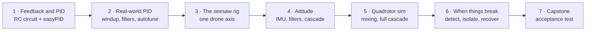

# Teach it: a drone-control bootcamp

I wrote a seven-evening course that takes engineering students from PID on a resistor and a capacitor to a quadrotor that survives losing a rotor, one feedback loop at a time.

<a href="https://github.com/Kronbii/drone-control-bootcamp/actions/workflows/ci.yml"></a>


*Three points on the arc, all simulation with assumed parameters: (1) P leaves an offset on an RC circuit, PI removes it, too much integral gain overshoots; (4) on the seesaw rig model, a tap swings a single loop to 17° and a rate and angle cascade to 13°; (6) after a rotor is lost, the passive controller diverges while detection and yaw-relaxed control recover.*

> **Status: designed, not yet taught.** The notebooks run, the sketches compile and the tests pass, but no student has taken the course and no rig has been built from these documents. The first cohort is planned for December 2026; the [pilot plan](cohort/pilot-plan.md) says what it will measure. Until then I can't say what students learn from it, and this repository claims no learning outcomes.

## What it is, and why

Most students meet control theory as transfer functions on a whiteboard. Then they meet a drone, and the gap is wide: noisy sensors, motors that lag, integrators that wind up, and a vehicle that flips in a fraction of a second when a gain is wrong. Students with printers and electronics still lack a structured path from "what is PID" to "how does a drone stay up, and what happens when a propeller breaks".

The course closes that gap in seven evenings of about three hours, in teams of three, with hardware cheap enough to break. It starts where mistakes are cheap, on the bench, moves to one drone axis on a rig, then to the full quadrotor and its faults in simulation. Every session has learning goals, lesson notes, an auto-checked Jupyter notebook, a lab, a quiz and a slide deck, and every lab is predicted in a notebook before it is measured.

It is taught with two of my own projects: [easyPID](https://github.com/Kronbii/easyPID), the Arduino library every lab uses, and my [rotor-fault study](https://github.com/Kronbii/rotor-fault-recovery), the simulator for session 6.

## At a glance

| | | |
|---|---|---|
| Sessions | **7** | about three hours each, plus an optional rig-build evening and an open-lab evening |
| Auto-checked exercises | **41** | in 7 notebooks, built into student and solution versions; CI executes all 14 |
| easyPID Python port | **≤ 4.8 × 10⁻⁴** | worst relative difference from the compiled C++ library over 3,274 randomised updates |
| Kit per team | **USD 96–168** | estimated from a parts list for the bench kit and rig, before shipping and contingency ([details](cohort/kit-and-costs.md)) |

## How the course builds up



1. **Bench PID.** A capacitor charging through a resistor is a first-order plant with an exact answer, so students predict a P controller's offset on paper, measure it on the bench and see the two agree. A three-stage RC ladder then adds enough lag to make windup, derivative noise, setpoint kick and relay autotuning interesting, each checked against a known result.
2. **One drone axis.** A two-motor seesaw with a potentiometer on the pivot, which a real drone never has. Students measure a thrust curve with a kitchen scale, run the rig with interlocks, and close the first loop on a clean, absolute angle.
3. **Attitude.** They fuse a gyro and an accelerometer from an MPU-6050 and measure their estimate against the potentiometer, so they see exactly how wrong it is. Then they build a rate and angle cascade from two easyPID instances and watch it absorb a tap a single loop cannot.
4. **The full vehicle.** A minimal quadrotor simulator checked against the research model: the allocation matrix, mixing priorities when motors saturate, and a position, velocity, attitude and rate cascade.
5. **Faults and capstone.** With the rotor-fault simulator, students derive why a quadrotor cannot hover once a rotor has lost too much thrust, detect and isolate a fault with CUSUM tests, and watch a yaw-relaxed controller keep a vehicle in the air after a rotor stops. The capstone is an acceptance test written as code that runs identically on the rig and on the rig model, so teams tune in simulation first and are scored the same way on hardware.

| session | after it, students can | hardware |
|---|---|---|
| [1 · Feedback and PID](sessions/01-feedback-and-pid/) | predict a P controller's offset and speed, write a PID that matches easyPID number for number, design PD for a second-order plant | Arduino + RC circuit |
| [2 · Tuning and real-world PID](sessions/02-tuning-and-real-world-pid/) | handle sampling, windup, derivative noise and setpoint kick; identify a plant; tune by reaction curve, relay autotune and by hand | 3-stage RC ladder |
| [3 · The seesaw rig](sessions/03-the-1dof-rig/) | model one drone axis, measure a thrust curve, explain why P alone fails, run the rig safely | two-motor seesaw rig |
| [4 · Rotations and attitude](sessions/04-rotations-and-attitude/) | use rotation matrices and quaternions, fuse gyro and accelerometer, tune a rate and angle cascade | rig + MPU-6050 |
| [5 · Quadrotor simulation](sessions/05-quadrotor-simulation/) | derive the allocation matrix, explain mixing priorities, tune a four-loop cascade, judge a model against a research model | simulation |
| [6 · When things break](sessions/06-when-things-break/) | derive the hover limit, detect and isolate a rotor fault, re-allocate, explain yaw-relaxed control, read a study's limits | simulation (+ optional rig) |
| [7 · Capstone](sessions/07-capstone/) | tune a controller to a written spec, test it the way it is scored, report the gap between model and hardware | rig or simulation |


## Quick start

**Students** need Python 3.11 or newer and the Arduino IDE or `arduino-cli`.

```bash
git clone https://github.com/Kronbii/drone-control-bootcamp
cd drone-control-bootcamp
python3 -m venv .venv && source .venv/bin/activate
pip install -e ".[notebooks,serial]"
pip install "rotorfault @ git+https://github.com/Kronbii/rotor-fault-recovery"   # session 6
jupyter lab notebooks/
```

For the labs, install the AVR core and **easyPID 1.1.0** from the Arduino Library Manager, open a folder in `arduino/` and upload. Full instructions, an offline fallback for rotorfault and troubleshooting are in [docs/setup.md](docs/setup.md).

**Instructors** start with the [instructor guide](instructor/guide.md) and the [cohort plan](cohort/plan.md). The rig is documented in [hardware/rig](hardware/rig/) and has to be built and commissioned before session 3.

```bash
make setup                          # venv, dev tools, rotorfault
make check                          # ruff and all tests, every notebook executed
make sketches EASYPID=../easyPID    # compile all sketches (or use the installed library)
make figures slides                 # regenerate figures/ and slides/pdf/
```

CI runs four jobs: lint; the easyPID port against the real C++ sources plus simulator, sketch and documentation checks; every notebook executed (solutions must pass every check, student versions may fail only at their exercises); and every sketch compiled for Uno and Nano with warnings treated as failures.

## Repository layout

```
sessions/            per session: overview and timings, notes, lab sheet, quiz
notebooks/           7 student notebooks (sources in notebooks/src/)
solutions/notebooks/ the same notebooks with solutions
arduino/             lab sketches for Uno and Nano, built on easyPID
src/bootcamp/        Python package: easyPID port, plants, rig model, attitude filters,
                     minimal quadrotor, fault helpers, capstone test, auto-checks
hardware/rig/        bill of materials, build guide, wiring, safety, OpenSCAD parts and STLs
slides/              Marp decks with prebuilt PDFs
instructor/          session plans, common mistakes, quiz keys
cohort/              cohort plan, kit and costs, pilot plan, feedback form
figures/             figures generated by the solution notebooks
docs/                setup guide and a project summary
tools/ tests/        build scripts and the test suite
```

## Limits and what's next

- **Not taught yet.** No student has taken the course; session timings, difficulty and the capstone pass limits are estimates.
- **No rig has been built from the documents.** The printable parts have not been printed, and the sketches' motor and IMU drivers have been compiled but not run on hardware.
- **Simulation with assumed values.** Rig parameters, capstone limits and every performance figure, including those from the rotor-fault study, come from simulation.
- **Costs are planning ranges** from typical listings, not quotes.
- **A flaw found along the way.** Testing easyPID for the course found a first-run bias in its relay autotuner: an ultimate gain of about 42 on the first run from rest and 28 on the second, against an exact 29. The lab runs it twice; the library is unchanged so far.

Next is the first cohort, planned for December 2026, measured as the [pilot plan](cohort/pilot-plan.md) describes.

## Read more

- Project page: [ramikronbi.com/projects/drone-control-bootcamp](https://ramikronbi.com/projects/drone-control-bootcamp)
- Write-up: [Teaching drone control from an RC circuit up](https://ramikronbi.com/writing/teaching-drone-control-from-an-rc-circuit-up)
- [easyPID](https://github.com/Kronbii/easyPID), the Arduino library every lab uses
- [rotor-fault-recovery](https://github.com/Kronbii/rotor-fault-recovery), the study behind session 6

Course material (notes, labs, quizzes, slides, instructor and cohort documents, hardware designs and figures) is licensed CC BY 4.0 ([LICENSE-CONTENT](LICENSE-CONTENT)); code (`src/`, `tools/`, `tests/`, `arduino/` and the notebook code) is MIT ([LICENSE](LICENSE)).

Built by Rami Kronbi — [ramikronbi.com](https://ramikronbi.com)
