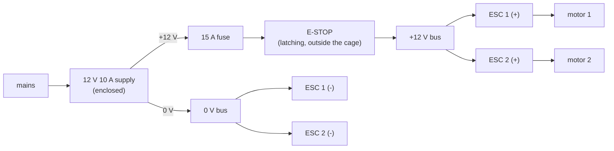

# Wiring

Two separate circuits that share only a ground: the **12 V power chain** to the ESCs
(up to 10 A) and the **5 V logic** of the Arduino, powered from the laptop's USB.

## Power chain



- 14 AWG wire for everything carrying motor current; keep the + and - wires twisted
  together.
- The e-stop breaks the **+12 V line to both ESCs**. Pressing it stops the motors whatever
  the software does. Test it at the start of every session (safety.md).
- The fuse sits directly at the supply's + terminal.
- Swap any two of the three motor wires to reverse a motor's direction.

## Signals (Arduino Nano / Uno)

```
  Arduino            connects to                    notes
  -------            -----------                    -----
  D9  (OC1A) ------- ESC 1 signal (white/yellow)    Timer1 PWM, 1000-2000 us, 250 Hz
  D10 (OC1B) ------- ESC 2 signal                   do not use the Servo library
  GND -------------- ESC 1 and ESC 2 signal ground  (brown/black wire of the servo lead)
  (ESC red 5 V BEC wire: NOT connected -- tape it back)

  A0 --------------- pot wiper (middle pin)         pot ends to 5V and GND
  A0 --[1 MOhm]----- GND                            pull-down: a loose wiper reads 0
  5V --------------- pot end 1, GY-521 VCC
  GND -------------- pot end 2, GY-521 GND, arm switch
  A4 (SDA) --------- GY-521 SDA
  A5 (SCL) --------- GY-521 SCL
  D2 --------------- arm switch (other side to GND) INPUT_PULLUP: closed = ON
  D13 -------------- on-board LED                   lit while armed
  USB -------------- laptop (power + serial log)
```

Pin assignments are in `arduino/common/rig_safety.h` (pins, limits, arming rules) and
`arduino/common/esc_timer1.h` (ESC outputs).

## Grounding and noise

- The only connection between the two circuits is the ESC signal ground to Arduino GND.
  It is needed: a PWM signal is measured against it.
- Route the IMU's I²C wires (A4/A5) away from the motor wires, twisted with a ground
  wire, and keep them short (< 30 cm). If the IMU drops out when the motors run, that is
  the first thing to check (`s04_imu_check` prints `IMU NOT FOUND` at boot; the cascaded
  sketches disarm when a read fails).
- The pot cable runs along an upright, not along the beam.
- The 1 MΩ pull-down on A0 makes a disconnected wiper read 0 instead of floating, so the
  plausibility check (10-1013 counts) catches it; a loose end wire drives the reading to a
  rail and is caught the same way. The pull-down shifts the reading by about one count
  near the centre, which `zero` removes.

## Before the first power-up

1. Props **off**. Supply unplugged.
2. Continuity check: no short between +12 V and 0 V (multimeter, both with the e-stop
   pressed and released).
3. ESC red wires taped back; signal wires on D9/D10; signal grounds on GND.
4. Upload `s03_esc_bench`, open the Serial Monitor, *then* power the supply and release
   the e-stop: the ESCs beep their start-up tune and stay silent (they see 1000 µs).
5. Continue with lab 3, part A (motor direction check, still without props).
