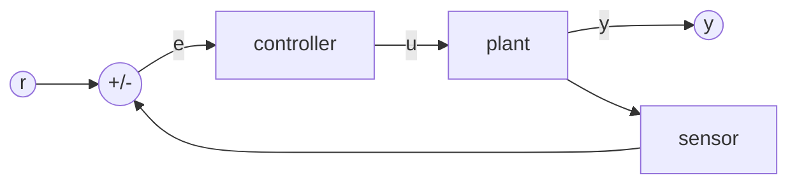

# Session 1 notes · Feedback and PID from first principles

These notes are the reading version of the evening. The notebook
(`notebooks/s01_feedback_pid.ipynb`) has the same material with code you run.

## 1. Open loop and closed loop

An **open-loop** controller computes its command from the goal alone: "the heater needs
60 % to reach 40 °C". It works only if the model is exact and nothing disturbs the
system. A **closed-loop** (feedback) controller measures the output $y$, compares it with
the setpoint $r$, and acts on the **error** $e = r - y$. Feedback trades the need for an
exact model for the need for a measurement -- and it brings a new risk, instability,
because the controller now reacts to its own past actions.



## 2. The first-order plant

Many physical systems are, on the time scale that matters, a **first-order lag**:

$$\tau\,\dot y + y = K u .$$

- $K$, the **static gain**: output change per unit input change, once settled.
- $\tau$, the **time constant**: after a step the output covers $1 - e^{-1} = 63.2\,\%$ of its
  change in $\tau$ seconds, 86.5 % in $2\tau$, 95 % in $3\tau$, 98 % in $4\tau$.

Examples: the voltage on a capacitor charged through a resistor ($\tau = RC$, $K = 1$);
the speed of a DC motor driven by a voltage; the temperature of a heated block; the
thrust of a propeller after an ESC command (session 3).

Step response from rest, for an input step $u_0$:

$$y(t) = K u_0\left(1 - e^{-t/\tau}\right).$$

**Reading $K$ and $\tau$ off a measurement.** Apply a step, wait until the output settles:
$K = \Delta y / \Delta u$. Then find the time at which the output has covered 63.2 % of
its change: that is $\tau$ (plus any dead time before the response starts).

### Simulating it

A computer steps the equation. Forward Euler,

$$y_{k+1} = y_k + \Delta t\,\frac{K u_k - y_k}{\tau},$$

is accurate when $\Delta t \ll \tau$ and *unstable* when $\Delta t > 2\tau$. The course
library uses the exact zero-order-hold solution instead (session 2):
$y_{k+1} = a y_k + K(1 - a) u_k$ with $a = e^{-\Delta t/\tau}$.

## 3. Proportional control

With $u = K_p e = K_p(r - y)$:

$$\frac{\tau}{1 + KK_p}\,\dot y + y = \frac{KK_p}{1 + KK_p}\,r .$$

The product $L = KK_p$ is the **loop gain**. The closed loop is first order with

| | open loop | closed loop (P) |
|---|---|---|
| time constant | $\tau$ | $\tau / (1 + L)$ |
| final value for setpoint $r$ | -- | $\frac{L}{1+L}\,r$ |
| steady-state error | -- | $\frac{r}{1 + L}$ |

So feedback makes the plant **faster** and **less sensitive** to its own gain (if $K$
doubles, the closed-loop gain $L/(1+L)$ barely moves when $L$ is large). But a P controller
always leaves an **offset**: to produce a non-zero output it needs a non-zero error.

**Worked example.** RC circuit, $K = 1$, $\tau = 1$ s, $K_p = 4$, setpoint 2.5 V:
final value $\frac{4}{5}\cdot 2.5 = 2.0$ V (offset 0.5 V), time constant 0.2 s.

**Saturation.** Real actuators have limits (0-5 V on a PWM pin). A large $K_p$ asks for
more than the actuator can give right after a setpoint change; while saturated the loop
is effectively open and the response is slower than the formula predicts. Session 2.

## 4. Integral and derivative action

The **PID** law:

$$u(t) = K_p\,e(t) + K_i\int_0^t e(\sigma)\,d\sigma + K_d\,\frac{de(t)}{dt}.$$

- **I** accumulates the error. In steady state $u$ is constant, so the integral must stop
  changing, so $e = 0$: **no offset**, for any constant setpoint or disturbance. Too much
  $K_i$ causes overshoot and oscillation.
- **D** reacts to the rate of change of the error: it anticipates, and acts like a
  damper. It amplifies measurement noise (session 2) and is useless on a pure first-order
  plant, but essential on plants with inertia.

Equivalent "standard" form used in many tuning rules: $K_i = K_p/T_i$, $K_d = K_p T_d$.

## 5. PID on a microcontroller: what easyPID computes

A microcontroller samples every $\Delta t$. easyPID (Rami Kronbi's Arduino library,
version 1.1.0, `PIDController` class) performs, on every call:

| step | formula |
|---|---|
| error | $e_k = r_k - y_k$ (negated internally in `REVERSE` mode) |
| P | $p_k = K_p e_k$ |
| I | $I_k = I_{k-1} + e_k\,\Delta t$, $\;i_k = K_i I_k$ |
| D | $d_k = K_d\,(e_k - e_{k-1})/\Delta t$, and $d_k = 0$ on the first call after `begin()`/`reset()` |
| output | $u_k = \min(\max(p_k + i_k + d_k,\ u_{min}),\ u_{max})$ |
| anti-windup | default `ANTIWINDUP_CLAMP` (session 2) |

API essentials (exactly as in the library):

```cpp
#include <easyPID.h>
PIDController pid(kp, ki, kd, outMin, outMax);   // limits are part of the constructor
void setup() { pid.begin(); }
void loop()  {
  float u = pid.update(setpoint, measurement);          // dt measured with millis()
  // or: pid.update(setpoint, measurement, dtMs);        // dt you supply, in MILLISECONDS
}
```

Two easyPID details that catch people out:

1. the explicit time step is in **milliseconds** (`update(sp, y, 10)` means 10 ms);
2. `update(sp, y)` returns the previous output if less than 1 ms has passed, so it is safe
   to call it from a fast `loop()` -- but a fixed sample period (as in every lab sketch)
   makes the behaviour reproducible.

The introspection getters `getError()`, `getPterm()`, `getIterm()`, `getDterm()`,
`getOutput()` let you log each term -- the lab sketches print all of them.

## 6. Second-order plants and why D exists

A plant that stores energy in two forms (a mass and a spring; a beam's inertia and gravity)
is second order:

$$\ddot y + 2\zeta\omega_n\dot y + \omega_n^2 y = K\omega_n^2 u .$$

- $\omega_n$: natural frequency (rad/s); $\zeta$: damping ratio.
- Step overshoot (for $\zeta < 1$): $M_p = e^{-\pi\zeta/\sqrt{1-\zeta^2}}$ -- 53 % at $\zeta = 0.2$,
  16 % at 0.5, 4.6 % at 0.7.
- 2 % settling time $\approx 4/(\zeta\omega_n)$.

With PD control and a constant setpoint:

$$\ddot y + (2\zeta\omega_n + K\omega_n^2K_d)\,\dot y + \omega_n^2(1 + KK_p)\,y = K\omega_n^2K_p\,r,$$

$$\omega_{cl} = \omega_n\sqrt{1 + KK_p}, \qquad \zeta_{cl} = \frac{2\zeta\omega_n + K\omega_n^2K_d}{2\,\omega_{cl}} .$$

$K_p$ makes the loop stiffer and faster but *less* damped; $K_d$ restores the damping.
Design recipe: choose $K_p$ for the speed you want, $K_d$ for $\zeta_{cl} \approx 0.7$-$0.9$,
then a small $K_i$ for zero offset.

**Worked example.** $K = 1$, $\omega_n = 2$, $\zeta = 0.2$. $K_p = 3$ gives $\omega_{cl} = 4$ rad/s;
$K_d = 1.5$ gives $\zeta_{cl} = (0.8 + 6)/8 = 0.85$. Adding $K_i = 2$: overshoot 0.5 %,
settling 1.3 s (notebook exercise 1.5).

## 7. Common mistakes

- Passing seconds to `update(sp, y, dt)` (it wants milliseconds): the integral becomes
  1000x too small and the derivative 1000x too large.
- Forgetting the output limits are a constructor argument: `PIDController pid(2, 1, 0, 0, 255)`
  clamps to 0-255.
- Expecting a P controller to reach the setpoint.
- Tuning D on a first-order plant: there is nothing for it to damp; it only adds noise.
- Reading the response on the Serial Monitor instead of the Serial Plotter / a log file.

## Further reading

- K. J. Åström, R. M. Murray, *Feedback Systems*, 2nd ed., Princeton University Press, 2021,
  chapters 1, 2 and 11 (free online from the authors).
- easyPID `README.md` and `docs/tuning_guide.md` (github.com/Kronbii/easyPID).
