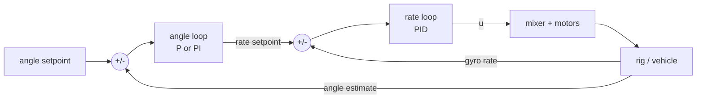

# Session 4 notes · Rotations, attitude estimation and cascaded loops

Conventions for the whole course (and the rotorfault study): world frame z up; body frame
x forward, y left, z up (FLU); $R$ maps body to world coordinates, $v_W = Rv_B$; Z-Y-X Euler
angles; scalar-first quaternions.

## 1. Rotation matrices and Euler angles

A rotation matrix is orthonormal ($R^TR = I$) with $\det R = 1$; its columns are the body
axes expressed in the world frame; $R^{-1} = R^T$. Elementary rotations:

$$R_x(\phi) = \begin{bmatrix}1&0&0\\0&c_\phi&-s_\phi\\0&s_\phi&c_\phi\end{bmatrix},\quad
R_y(\theta) = \begin{bmatrix}c_\theta&0&s_\theta\\0&1&0\\-s_\theta&0&c_\theta\end{bmatrix},\quad
R_z(\psi) = \begin{bmatrix}c_\psi&-s_\psi&0\\s_\psi&c_\psi&0\\0&0&1\end{bmatrix}.$$

**Z-Y-X (yaw-pitch-roll)**: $R = R_z(\psi)R_y(\theta)R_x(\phi)$ -- yaw about world z, then pitch
about the new y, then roll about the newest x. Recovering the angles:

$$\theta = -\arcsin R_{31}, \qquad \phi = \operatorname{atan2}(R_{32}, R_{33}), \qquad \psi = \operatorname{atan2}(R_{21}, R_{11}).$$

**Gimbal lock**: at $\theta = \pm 90°$ the roll and yaw axes coincide; only $\phi \mp \psi$ is
defined, and Euler-angle rates blow up. Attitude controllers therefore work with $R$ or a
quaternion (the rotorfault study uses a geometric controller on SO(3)); Euler angles stay
for display and small-angle control around hover.

Order matters: $R_zR_yR_x \ne R_xR_yR_z$. Try it in the notebook.

## 2. Quaternions, lightly

A unit quaternion $q = (\cos\frac\alpha2,\ \sin\frac\alpha2\,\mathbf n)$ is a rotation by $\alpha$
about the unit axis $\mathbf n$. Four numbers, one constraint, no singularity.

- Product: $q_a\otimes q_b = (w_aw_b - \mathbf v_a\cdot\mathbf v_b,\ w_a\mathbf v_b + w_b\mathbf v_a + \mathbf v_a\times\mathbf v_b)$;
  $q_a\otimes q_b$ means "rotate by $q_b$, then by $q_a$" (same order as $R_aR_b$).
- Rotating a vector: $(0, v') = q\otimes(0, v)\otimes q^*$, with $q^* = (w, -\mathbf v)$.
- Gyro integration: $q_{k+1} = q_k\otimes\big(\cos\frac{|\omega|\Delta t}{2},\ \sin\frac{|\omega|\Delta t}{2}\,\frac{\omega}{|\omega|}\big)$,
  then renormalise.
- $q$ and $-q$ are the same rotation.

## 3. What an IMU measures

**Gyroscope**: body angular rate $\omega$, plus a bias $b$ that drifts slowly (MEMS gyros:
up to a few deg/s, temperature dependent) and noise. Integrating the gyro gives a smooth
angle that **drifts** without bound: $\int b\,dt$.

**Accelerometer**: *specific force* $f = R^T(a - g_{vec})$, i.e. acceleration minus gravity,
in body axes. At rest $f = R^T(0, 0, g)$, so for Z-Y-X angles

$$f/g = (-\sin\theta,\ \sin\phi\cos\theta,\ \cos\phi\cos\theta) \Rightarrow
\phi = \operatorname{atan2}(f_y, f_z),\quad \theta = \operatorname{atan2}\!\big(-f_x, \sqrt{f_y^2+f_z^2}\big).$$

On the rig (IMU on the pivot axis, x along the beam): $\theta_{acc} = \operatorname{atan2}(a_x, a_z)$.
The accelerometer angle is **unbiased but noisy** and **wrong whenever the sensor
accelerates**: propeller vibration (tenths of a g on a rig with 10-inch props), and, if the
IMU sits $r$ metres from the pivot, the centripetal ($-r\dot\theta^2$) and tangential
($r\ddot\theta$) accelerations. Mount it on the axis of rotation and close to the centre of
mass on a drone; isolate vibration mechanically.

The MPU-6050 settings in `mpu6050_lite.h`: gyro ±500 deg/s (65.5 LSB per deg/s),
accelerometer ±4 g (8192 LSB per g), internal low-pass about 44 Hz. The sketches measure the
gyro bias at boot (beam still for 2 s).

## 4. The complementary filter

$$\hat\theta_k = \alpha(\hat\theta_{k-1} + \omega_k\Delta t) + (1-\alpha)\theta_{acc,k}, \qquad \alpha = \frac{\tau}{\tau + \Delta t}.$$

In the frequency domain it is a low-pass on the accelerometer plus a high-pass on the
(integrated) gyro, with the same crossover time constant $\tau$; the two filters sum to one,
so a perfect pair of sensors would pass through unchanged.

- Small $\tau$: accelerometer noise and vibration come through.
- Large $\tau$: a gyro bias $b$ leaves a steady error of about $b\tau$; recovery after a
  disturbance takes several $\tau$.
- On the rig model, with motors running, the error is smallest around $\tau \approx 0.5$ s
  (notebook 4, the $\tau$ sweep). `BeamImu` defaults to 0.5 s; the `tau` command changes it.

## 5. A preview of the Kalman filter

State $x = [\theta,\ b]$ (angle and gyro bias), input the gyro rate, measurement the
accelerometer angle:

- predict: $\theta^- = \theta + (\omega - b)\Delta t$, $b^- = b$, $P^- = FPF^T + Q$, $F = \begin{bmatrix}1 & -\Delta t\\0 & 1\end{bmatrix}$;
- correct: $K = P^-H^T(HP^-H^T + r)^{-1}$, $H = [1\ 0]$, $x = x^- + K(\theta_{acc} - \theta^-)$, $P = (I - KH)P^-$.

Compared with the complementary filter it chooses its gain from the noise statistics
($Q$, $r$), changes the gain over time, and **estimates the gyro bias**, so the $b\tau$ error
disappears. Flight controllers use extended or error-state Kalman filters on quaternions;
the rotorfault study uses a complementary attitude filter with bias estimation plus a
Kalman filter for position and velocity.

## 6. Cascaded control

Each axis of a flight controller is two nested loops:

- The **inner rate loop** uses the gyro: low noise, no drift problem over its short time
  scale, almost no delay. A disturbance torque shows up in the rate immediately, so the
  inner loop fights it before the angle has moved much.
- The **outer angle loop** is slower (typically 3-10x lower bandwidth) and only has to
  produce a rate setpoint. Its output limit is a natural rate limit (`rmax`).
- **Tune inside out**: inner loop first (rate steps with the outer loop off, or a low outer
  gain), then the outer loop. Rule of thumb: raise `rkp` until the rate tracks crisply,
  add a little `rki`, keep `rkd` small and filtered; then raise `akp`.

On the rig model, the cascade on the IMU estimate (gains 4 | 3, 1, 0.05) cut the deviation
after a tap from 7° (single PID loop on the pot) to 3° (notebook 4, figure `s04_cascade`).
These numbers are from simulation; the lab measures the real ones.

## Common mistakes

- Wrong IMU axis or sign: the inner loop becomes positive feedback. Check with the beam
  tilted by hand *before* arming (`s04_imu_check`).
- Moving the beam during the boot-time gyro calibration.
- Tuning the outer loop before the inner loop works.
- An outer-loop integral fighting an inner-loop integral (start with `aki 0`).
- Expecting the accelerometer angle to be right while the beam swings.

## Further reading

- R. Mahony, T. Hamel, J.-M. Pflimlin, "Nonlinear complementary filters on the special
  orthogonal group", *IEEE Trans. Automatic Control*, 53(5), 2008.
- J. Solà, "Quaternion kinematics for the error-state Kalman filter", arXiv:1711.02508, 2017.
