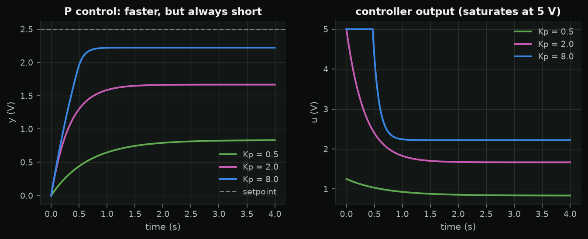
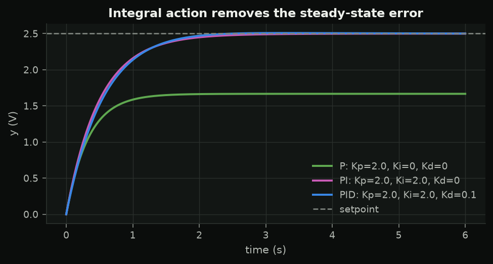
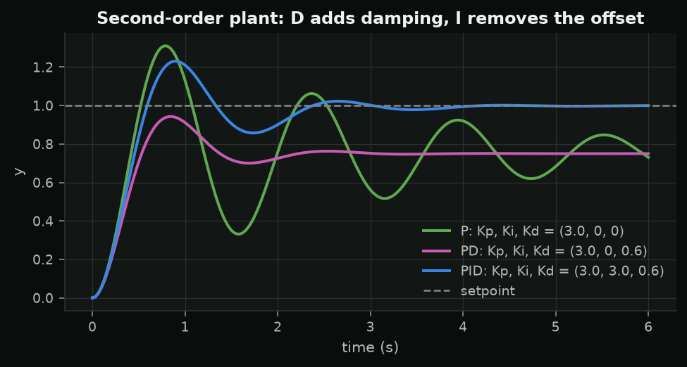
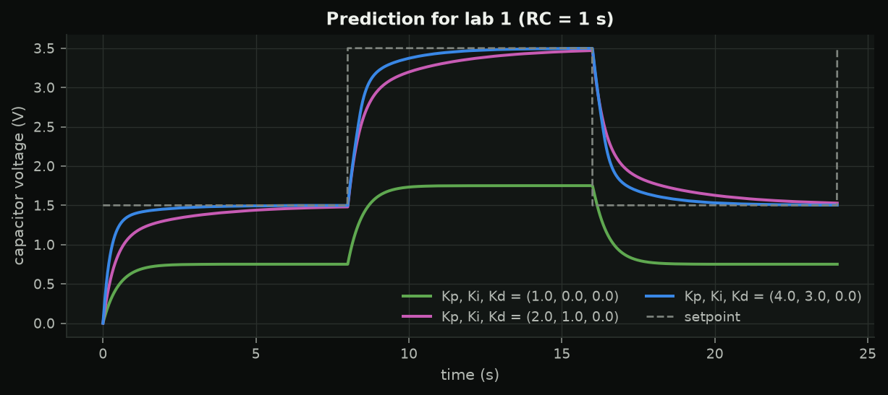

<!-- _class: title -->
<!-- _paginate: false -->

<p class="slate">SC 01 · feedback and PID</p>

# Feedback and PID from first principles

Seven evenings from a capacitor to a quadrotor that survives losing a rotor. Tonight: why feedback works, and the PID you will flash on an Arduino.

---

## The arc


PID on a circuit → one drone axis on the bench → a quadrotor in simulation → faults.

---

## Tonight you will

- predict a first-order plant's step response
- predict the **offset** and **speed** of a P controller before simulating it
- write a PID update that matches **easyPID** number for number
- design PD for a plant with inertia
- run easyPID on a simulated plant, then on a real RC circuit

---

## Open loop vs closed loop

<div class="cols">
<div>

**Open loop**: "60 % heater gives 40 °C". Works if the model is exact and nothing changes.

**Closed loop**: measure $y$, act on $e = r - y$.

> Feedback trades the need for a model for the need for a measurement -- and brings a new risk: instability.

</div>
<div>

```
 r -->(+/-)--e--> C --u--> G --+--> y
        ^                      |
        +------- sensor <------+
```

</div>
</div>

---

## The first-order plant

$$\tau\dot y + y = Ku \qquad\Rightarrow\qquad y(t) = Ku_0\left(1 - e^{-t/\tau}\right)$$

- $K$: output per unit input, once settled
- $\tau$: 63 % of the way in $\tau$, 95 % in $3\tau$
- the lab plant: $10\,\text{k}\Omega \times 100\,\mu\text{F}$, $\tau = RC = 1$ s, $K = 1$

**Predict:** an RC circuit driven with 2.5 V. Voltage after 1 s?

---

## P control: faster, but always short

$$u = K_p(r - y) \;\Rightarrow\; y_\infty = \frac{KK_p}{1 + KK_p}\,r,\qquad \tau_{cl} = \frac{\tau}{1 + KK_p}$$



---

## PID, and what easyPID computes

$$u = K_pe + K_i\!\int e\,dt + K_d\,\dot e$$

| term | every call |
|---|---|
| I | $I \mathrel{+}= e\,\Delta t$ |
| D | $(e_k - e_{k-1})/\Delta t$, **zero on the first call** |
| out | clamp to `outMin..outMax` |

```cpp
PIDController pid(kp, ki, kd, outMin, outMax);
float u = pid.update(setpoint, measurement, dtMs);   // dt in MILLISECONDS
```

---

## Integral action removes the offset



Too much $K_i$: overshoot. On a first-order plant, D adds nothing but noise.

---

## Plants with inertia need D

$$\omega_{cl} = \omega_n\sqrt{1+KK_p},\qquad \zeta_{cl} = \frac{2\zeta\omega_n + K\omega_n^2K_d}{2\omega_{cl}}$$



---

## Lab 1

<div class="cols">
<div>

**A · no wiring**: `s01_sim_plant` simulates the plant on the board; tune live over serial (`kp 4`, `ki 1`, `dist 20`).

**B · RC circuit**: D5 → 10 kΩ → A0 → 100 µF → GND. `s01_rc_plant`, open loop, P, PI, logged.

Hand in: measured τ, P-only final value, PI overshoot, one plot vs prediction.

</div>
<div>



</div>
</div>

---

## Summary

- Feedback: speed and robustness, at the risk of instability
- P leaves $r/(1+KK_p)$; I removes it; D damps inertia
- easyPID = the discrete PID you wrote, plus limits and anti-windup (next week)
- `update(sp, y, dtMs)`: **milliseconds**

Quiz 1 · next week: real-world PID
