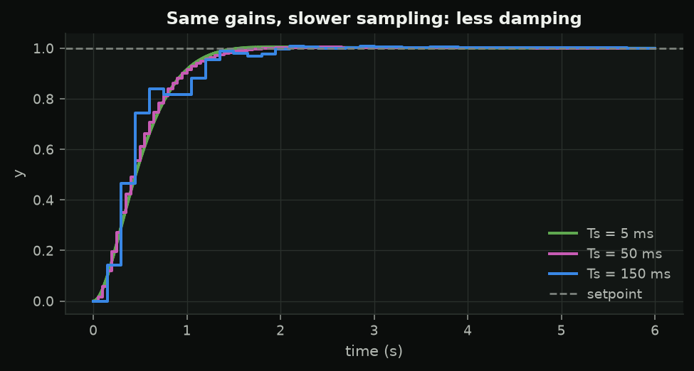
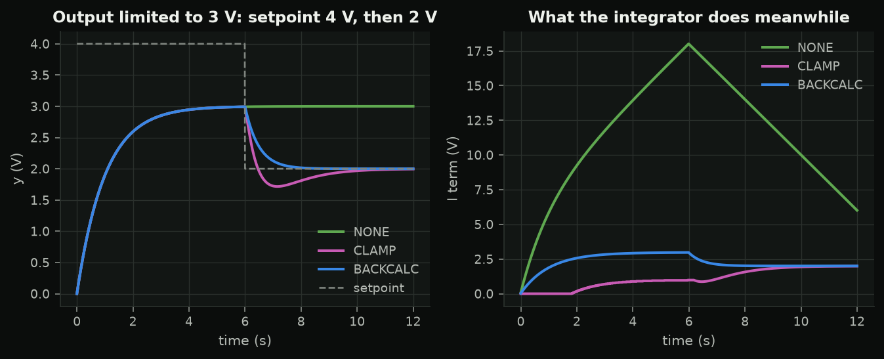
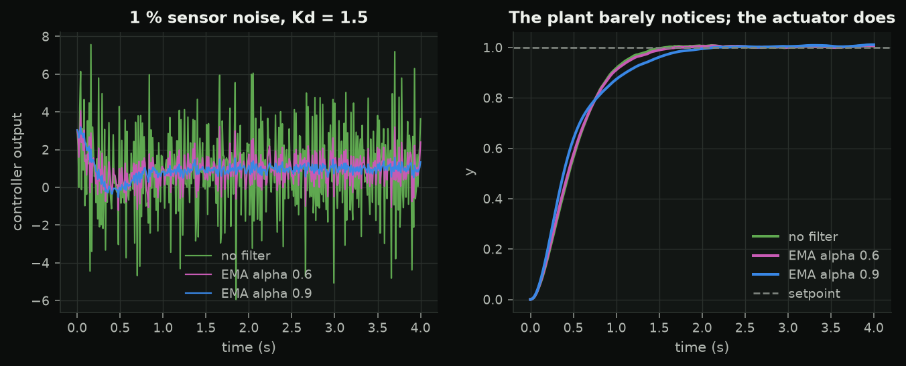
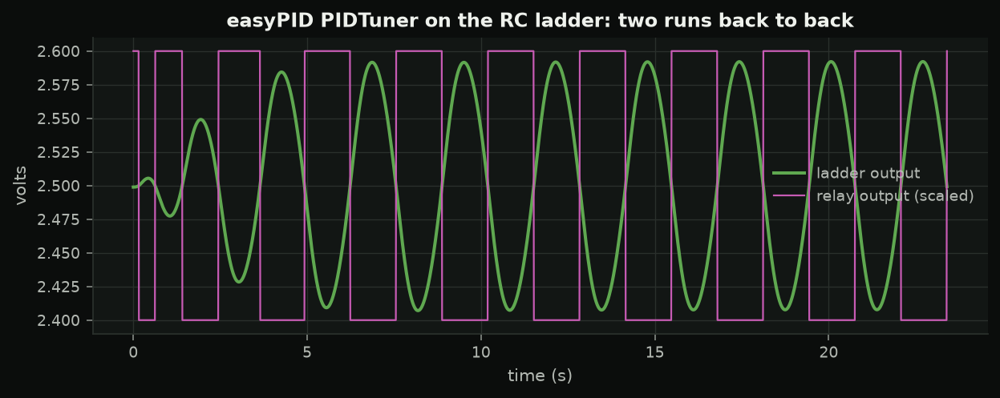
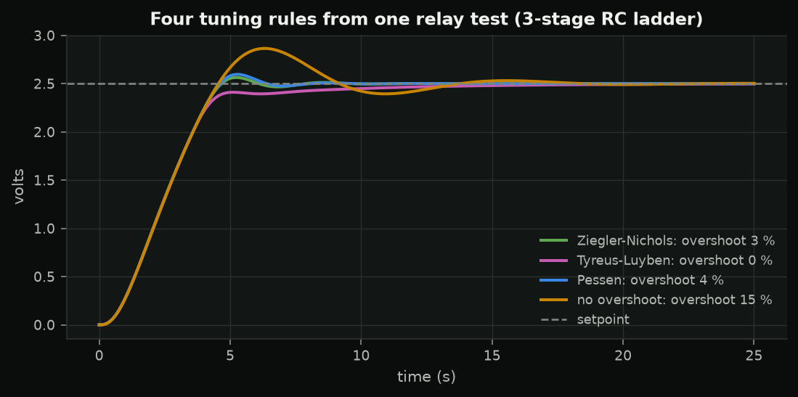

<!-- _class: title -->
<!-- _paginate: false -->

SC 02 · tuning and real-world PID

# Real hardware breaks textbook PID

Five problems -- sampling, saturation, noise, setpoint jumps, unknown plants -- and the easyPID feature for each.

---

## Sampling costs phase

$$y_{k+1} = e^{-T_s/\tau}y_k + K(1-e^{-T_s/\tau})u_k \qquad \text{hold delay} \approx T_s/2 \;\Rightarrow\; -360fT_s/2\ \text{degrees}$$

Rule of thumb: sample 10-20x faster than the loop bandwidth.

---

## Saturation and windup

`ANTIWINDUP_CLAMP` (default): undo this sample's integration if it pushes further into the limit. `BACKCALC`: bleed the excess back through $1/K_i$.

---

## Derivative noise: the EMA filter

$$d^f_k = \alpha d^f_{k-1} + (1-\alpha)d_k,\qquad f_c = -\frac{\ln\alpha}{2\pi T_s}$$

Same `alpha`, different loop rate → different filter.

---

## Setpoint jumps kick the D term

easyPID differentiates the **error**: a setpoint step gives one sample of $K_d\Delta r/\Delta t$.

Fix: ramp the setpoint (`ramp 0.05` in the lab sketch), or differentiate the measurement.

---

## Measure, don't eyeball

| metric | definition |
|---|---|
| rise time | 10 % → 90 % of the step |
| overshoot | $100(y_{peak} - r)/(r - y_0)$ |
| settling | stays within 2 % (or a ±band) |
| steady-state error | $r$ − mean of the last 10 % |

`bootcamp.metrics.step_info` -- used for every spec in the course.

---

## Identify: first order plus dead time

$$G(s) = \frac{Ke^{-Ls}}{\tau s+1},\qquad \tau = 1.5(t_{63} - t_{28}),\quad L = t_{63} - \tau$$

The 3-stage RC ladder (exact: $1/(1+6sT+5s^2T^2+s^3T^3)$) fits $K=1$, $\tau\approx5.1$ s, $L\approx0.95$ s.

Reaction-curve rule (easyPID tuning guide): $K_p = 1.2\tau/(KL)$, $K_i = K_p/2L$, $K_d = 0.5K_pL$.

---

## Relay autotuning: easyPID `PIDTuner`

$$K_u = \frac{4d}{\pi\sqrt{a^2 - h^2}}, \qquad P_u = \text{period}$$

---

## Test your tools on a known answer

RC ladder: exact $K_u = 29$, $P_u = 2.57$ s.

| run | $K_u$ | $P_u$ |
|---|---|---|
| 1st, from rest | 42 | 2.04 s |
| 2nd, straight after | 28 | 2.64 s |

The first run averages a still-growing oscillation. The lab sketch runs the tuner **twice**. The noise band (hysteresis) biases $K_u$ low: keep $h/a$ small.

---

## Four rules from one test

---

## Lab 2 · 3-stage RC ladder, `s02_rc_tuning`

- **A** open-loop step → FOPDT → reaction-curve gains
- **B** `tune 2.0 0.005` → $K_u$, $P_u$, four rules; check by hand
- **C** windup on purpose: `lim 0 3`, `aw none / clamp / backcalc`
- **D** `ts 200`, `filter 0.7` if time allows

Never relay-tune something that cannot oscillate safely -- like next week's rig.
