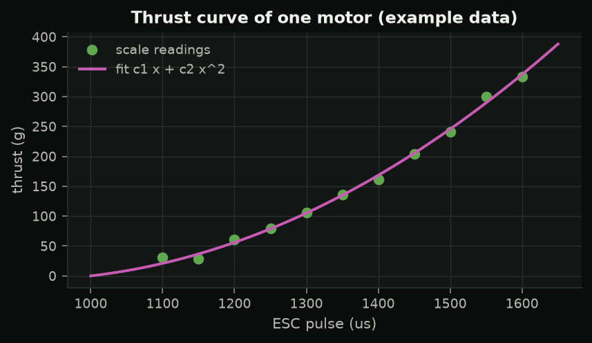
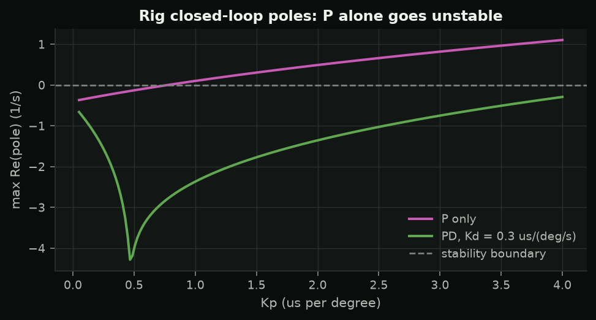
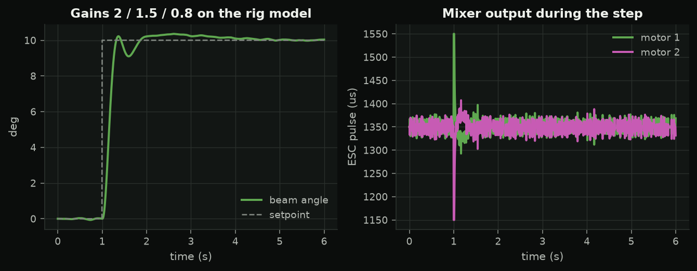

<!-- _class: title -->
<!-- _paginate: false -->

SC 03 · the seesaw rig

# One axis of a drone, on the bench

Differential thrust, a mixer, and the first spinning propellers of the bootcamp.

---

<!-- _class: safety -->

## Safety first, every rig session

1. Props **off** for wiring, ESC setup, direction checks
2. **Cage closed** before power; supply off before opening
3. **Glasses** on; nobody crosses the line
4. **Two roles**: operator (laptop) and safety officer (hand by the e-stop)
5. Something unexpected → **e-stop first**
6. Never raise `US_CAP` or remove an interlock

Layers: distance → e-stop in the 12 V line → guards → software interlocks → people.

---

## The rig is a drone's roll axis

$$J\ddot\theta = l(T_1 - T_2) - mgh\sin\theta - b\dot\theta$$

| $h$ (CG below pivot) | behaves like |
|---|---|
| $> 0$ | a pendulum |
| $= 0$ | a hovering drone |
| $< 0$ | an inverted pendulum |

Mixer: $\text{us}_{1,2} = \text{base} \pm u$, shifted near the limits (air mode).

---

## Thrust from a kitchen scale

Rest the motor-2 end on a tared scale, spin motor 1: the reading rises by exactly $T_1$.

$$T(x) = c_1x + c_2x^2,\qquad k_u = 2l\,\frac{c_1 + 2c_2x_0}{1000}\ \text{N m/µs}$$

---

## The free swing gives the CG offset

$$T_{swing} = 2\pi\sqrt{\frac{J}{mgh}} \quad\Rightarrow\quad h = \frac{J}{mg}\left(\frac{2\pi}{T_{swing}}\right)^2$$

A phone stopwatch and a kitchen scale measure a number that is hard to measure directly -- and that decides how the rig behaves.

---

## Why P alone fails

Pendulum + motor lag: P adds stiffness, not damping. **Attitude control needs rate feedback.**

---

## Design in simulation

Spec: overshoot < 15 %, settle into ±1° < 2 s, also stable with the CG on the pivot.

---

## Then walk the gains up on the rig

1. start at `kp 0.5 ki 0 kd 0.3`
2. `seq` (0 → +10 → -10 → 0°), log, compare with the model
3. raise `kd`, then `kp`, ~25 % per run, one change at a time
4. `ki` last, to remove the offset
5. stop at the spec, or when the motors sound rough

Every model parameter is an assumption until you measure it.

---

## Lab 3

- **A** props-off commissioning: e-stop, interlocks, directions → **sign-off**
- **B** thrust curve with `s03_esc_bench sweep 1`
- **C** free swing → $h$
- **D** first closed loop with `s03_rig_angle_pid`

Hand in: thrust sheet, $c_1, c_2, h$, a logged step next to the prediction.
