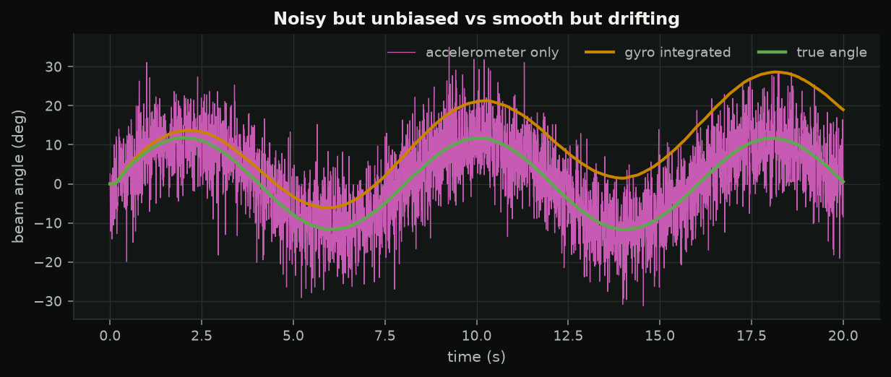
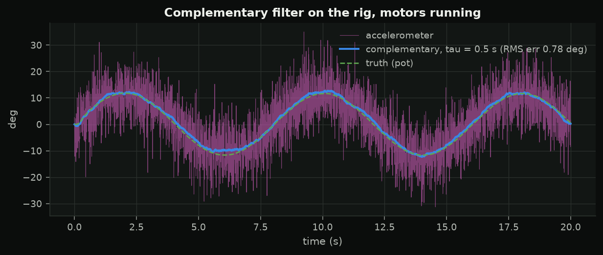
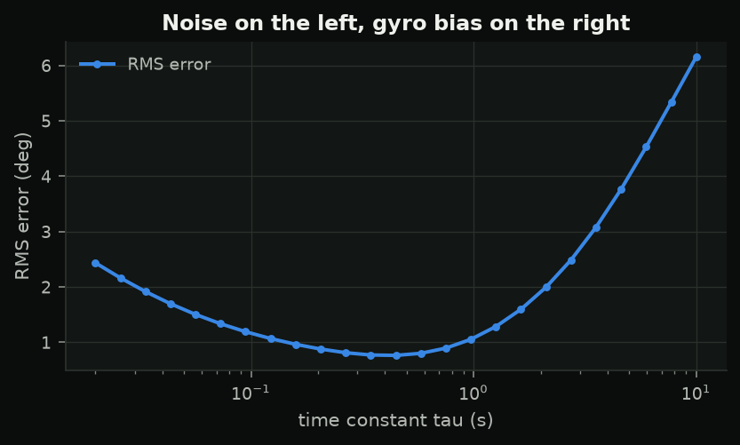
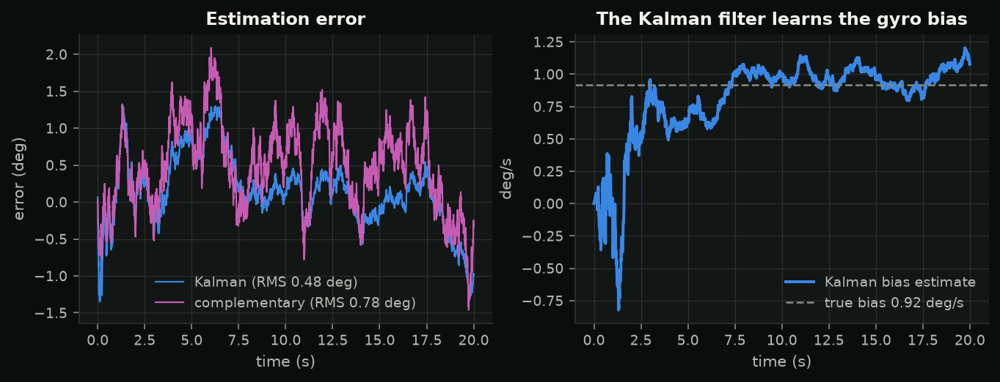
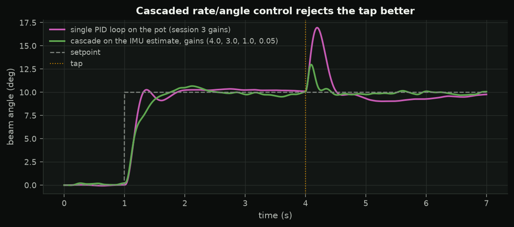
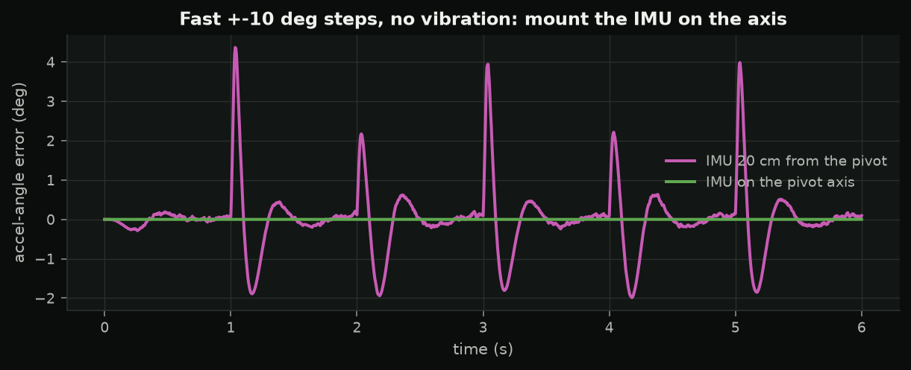

<!-- _class: title -->
<!-- _paginate: false -->

<p class="slate">SC 04 · rotations and attitude</p>

# A drone has no potentiometer

Rotations, what an IMU really measures, a filter that blends gyro and accelerometer, and the cascade every flight controller runs.

---

## Rotation matrices, Z-Y-X

$$R = R_z(\psi)\,R_y(\theta)\,R_x(\phi), \qquad v_W = Rv_B,\qquad R^{-1} = R^T$$

- columns of $R$ = body axes in world coordinates
- order matters: $R_zR_y \ne R_yR_z$
- **gimbal lock** at $\theta = \pm90°$: roll and yaw axes coincide

World z up, body x forward / y left / z up -- same as the rotorfault study.

---

## Quaternions, lightly

$$q = \left(\cos\tfrac\alpha2,\ \sin\tfrac\alpha2\,\mathbf n\right),\qquad v' = q\otimes(0,v)\otimes q^*$$

- four numbers, no singularity
- composition = quaternion product
- gyro integration: $q_{k+1} = q_k \otimes \exp(\tfrac12\omega\Delta t)$, renormalise

---

## What the IMU says



Gyro: smooth, drifts (bias). Accelerometer: unbiased at rest, noisy, fooled by any acceleration.

---

## Complementary filter

$$\hat\theta_k = \alpha(\hat\theta_{k-1} + \omega_k\Delta t) + (1-\alpha)\theta_{acc},\qquad \alpha = \frac{\tau}{\tau + \Delta t}$$



---

## Choosing τ

<div class="cols">
<div>



</div>
<div>

- small τ: vibration comes through
- large τ: gyro bias leaks in ($\approx b\tau$), slow recovery
- the **Kalman filter** estimates the bias as a state and picks its own gain

</div>
</div>

---

## Kalman preview: learning the bias



---

## The cascade every flight controller runs

```
angle sp --> [angle loop: P] --> rate sp --> [rate loop: PID] --> mixer --> motors
                 ^ angle estimate                ^ gyro rate
```

- inner loop on the gyro: fast, clean, sees a push immediately
- outer loop 3-10x slower; its output limit is a rate limit
- **tune inside out**

---

## It rejects disturbances better



Simulation with assumed parameters: tap deviation 7° → 3°. The lab measures yours.

---

## Mount the IMU on the axis



---

## Lab 4

- **A** `s04_imu_check`: pot vs accelerometer vs gyro vs filter, motors off and on
- **B** `s04_rig_cascaded`: inner loop first, then outer; `kick` for disturbances; `src imu` for drone mode

Check IMU signs by hand **before** arming. Keep the beam still during the gyro calibration.
