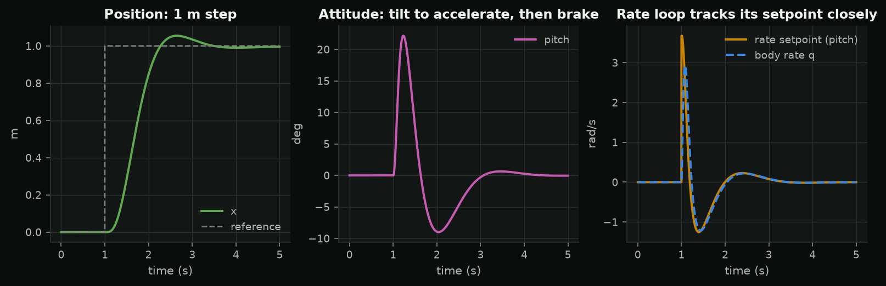
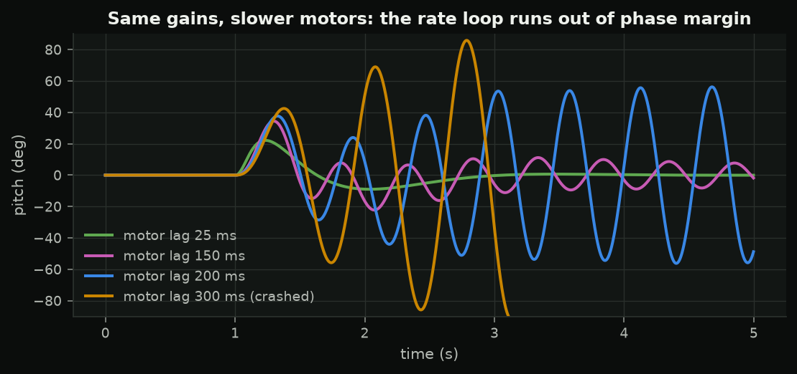
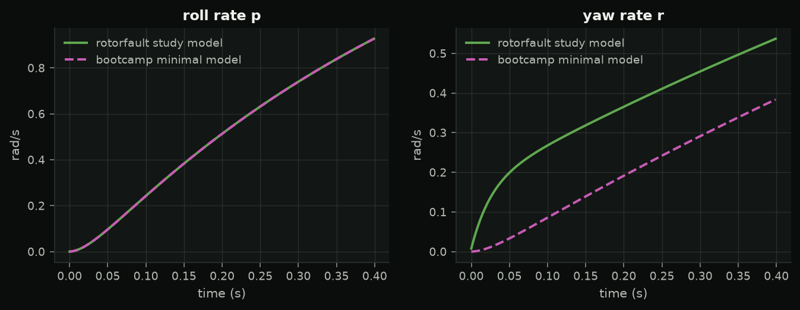

<!-- _class: title -->
<!-- _paginate: false -->

SC 05 · quadrotor simulation

# From one axis to six degrees of freedom

The equations, the mixing matrix, and the cascade, on the 5-inch quad of the rotorfault study.

---

## Rigid body in one screen

$$m\dot v = R\,(0,0,T)^T - RDR^Tv - mg\,e_3,\qquad J\dot\omega = \tau - \omega\times J\omega - K_\omega\omega$$

- thrust only along body z: **tilt to move**
- rotor: $f_i = k_f\Omega_i^2$, reaction torque $s_i\kappa f_i$, lag $\tau_m = 25$ ms
- `bootcamp.quad`: ~300 lines, RK4, every PID is easyPID

---

## The allocation matrix

$$\begin{bmatrix}T\\\tau_x\\\tau_y\\\tau_z\end{bmatrix} = \begin{bmatrix}1&1&1&1\\-a&a&a&-a\\-a&-a&a&a\\\kappa&-\kappa&\kappa&-\kappa\end{bmatrix}f$$

Square and invertible: four motors, four quantities, **no spare actuator**.

Hover: $f_i = mg/4$, $\Omega_h = \sqrt{mg/4k_f} \approx 1321$ rad/s, thrust-to-weight 3.6.

---

## When the motors saturate

1. keep **roll/pitch** (it keeps you in the air)
2. shift **collective thrust** (air mode)
3. scale **yaw** first: small authority ($\kappa$ = 1.5 cm vs a 7.8 cm lever), harmless to lose

---

## Acceleration → tilt

$$\theta_d = \frac{a_x\cos\psi + a_y\sin\psi}{g},\qquad \phi_d = \frac{a_x\sin\psi - a_y\cos\psi}{g}$$

$$T = \frac{m(g + a_z)}{\cos\phi\cos\theta}$$

---

## The cascade

position (P) → velocity (PI) → attitude (P) → rate (PID): each loop several times faster than the one around it.

---

## Actuator lag sets the inner-loop limit

---

## Minimal model vs research model

Roll agrees to $10^{-5}$; yaw does not. What is missing?

---

## Lab 5 · the failure catalogue

1. baseline course
2. slow motors (`motor_scale`)
3. heavier than the controller thinks
4. noisy gyro and the D filter
5. less thrust margin ($T/W$ 1.65) → session 6
6. the rotorfault CLI

Hand in: one plot and two sentences per failure.
