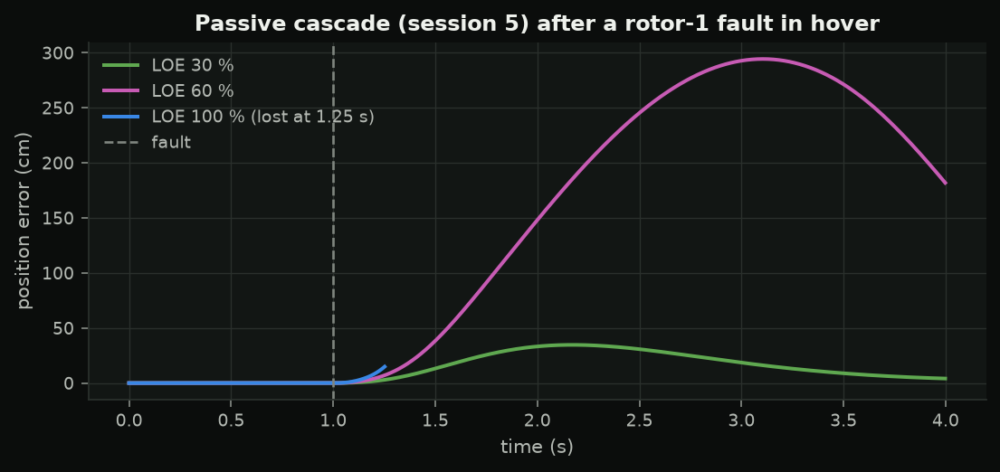
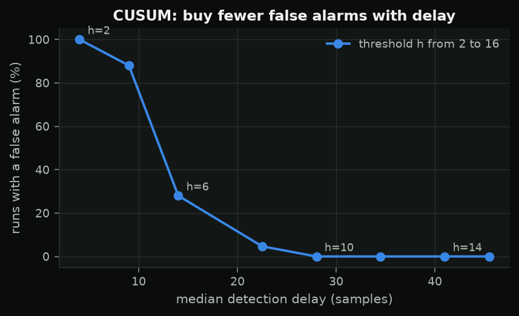
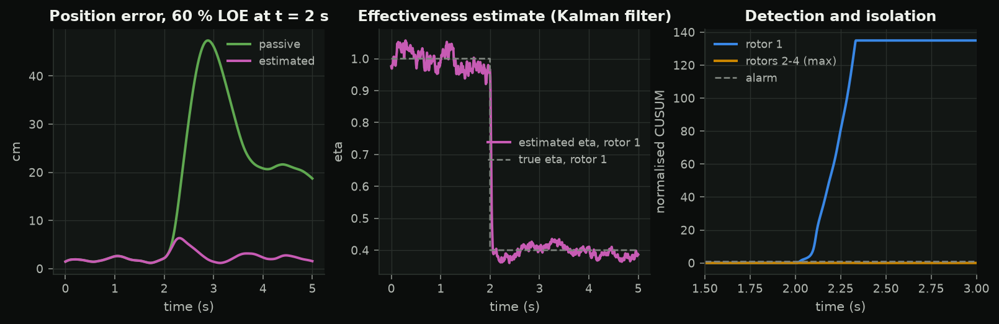
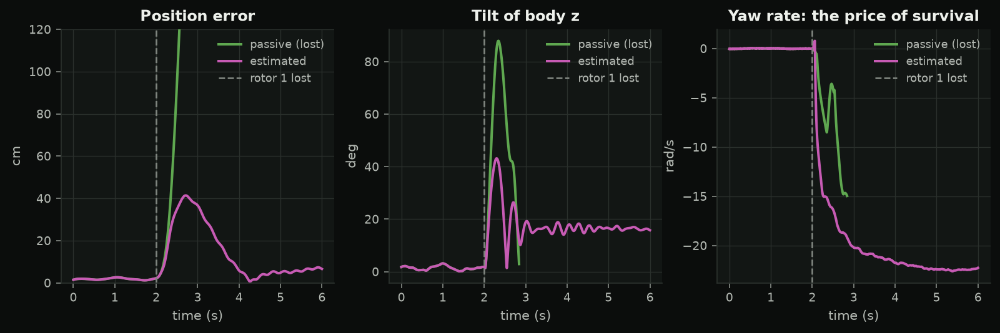

<!-- _class: title -->
<!-- _paginate: false -->

SC 06 · when things break

# Detect, isolate, recover

A chipped prop, a dead ESC: what a quadrotor can and cannot survive, using the rotorfault simulation study.

---

## Loss of effectiveness

$$\begin{bmatrix}T\\\tau\end{bmatrix} = B\,\mathrm{diag}(\eta)\,f,\qquad \eta_j\in[0,1]$$

Hover with heading held needs every rotor to give $mg/4$:

$$\eta_j \ge \frac{1}{T/W} \qquad (= 0.28\ \text{for the study's quad})$$

---

## A passive controller

Integral action absorbs a moderate loss; a complete loss flips it in ~0.3 s.

---

## Residuals and signatures

$$r = -\delta_j B_{:,j}f_j + \text{noise} = \delta_j d_j + \text{noise},\qquad \hat j = \arg\max_j \frac{d_j^Tr}{\lVert d_j\rVert}$$

Each rotor pushes the residual along a known direction.

---

## CUSUM: evidence over time

$$g_k = \max\Big(0,\ g_{k-1} + \frac{\mu_1}{\sigma^2}\big(r_k - \tfrac{\mu_1}{2}\big)\Big) > h$$

---

## The rotorfault pipeline, 60 % loss

Estimator → filtered regression → Kalman filter on $\eta$ → CUSUM bank → supervisor → re-allocation with $B\,\mathrm{diag}(\hat\eta)$.

---

## Complete loss: give up yaw

Spin about a tilted primary axis (Mueller & D'Andrea, 2014); control its direction and the thrust. 24 rad/s, inside the gyro range.

---

## Read the limits first

From the study's own section 6:

- simulation only, **assumed** parameters
- white-noise vibration, motion capture, one clean step fault
- recovery **failed** at 24 ms actuator delay, 80 ms motor lag, 3x turbulence

A good study tells you where it breaks.

---

## Lab 6

- **A** rotorfault: loss sweep, detection delay, false alarms, the motor-lag limit
- **B** (optional, rig) `fault 0.7` and your own CUSUM on the controller effort

Then: capstone teams and tracks.
