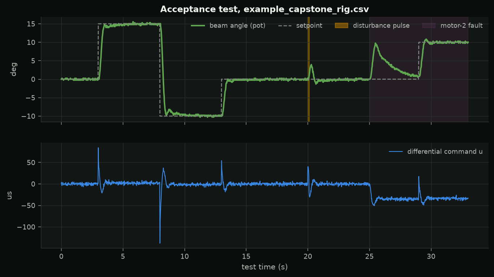
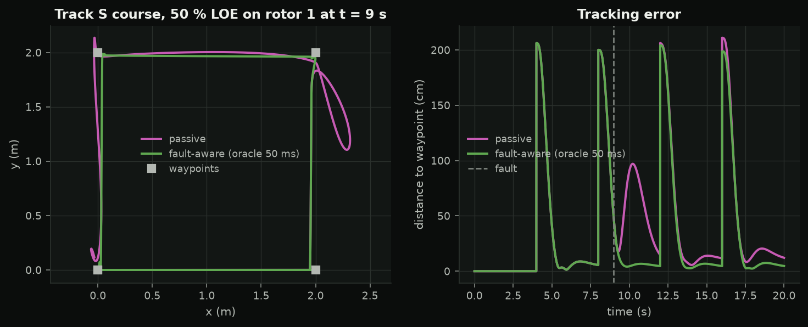

<!-- _class: title -->
<!-- _paginate: false -->

SC 07 · capstone

# Tune it, test it, report it

Numbers against a written specification, the plots that show them, and an honest two pages.

---

## Two tracks

### R · the rig

`s07_capstone`, command `test`: steps, a disturbance pulse, an injected motor fault. Worst of three runs against `RIG_SPEC`.

### S · simulation

Quadrotor course with 50 % loss on rotor 1 at t = 9 s. Replace the oracle with **your** detector and estimator.

---

## The acceptance test

Synthetic example log from the rig model -- yours will look different.

---

## The specification (track R)

| line | limit |
|---|---|
| +15° step overshoot | ≤ 20 % |
| settling into ±1° | ≤ 2.0 s |
| hold error | ≤ 1.0° |
| disturbance peak / recovery | ≤ 8° / ≤ 1.5 s |
| error with the fault | ≤ 1.5° |
| command chatter (RMS) | ≤ 25 µs |

---

## Track S: the course

---

## How to work

1. model first: your measured parameters, two seeds, margin
2. hardware gently: half the gains, then 25 % steps
3. test the way you are scored, log everything
4. explain the gap between model and hardware

An honest, measured failure scores better than an unexplained pass.

---

## Tonight

| time | |
|---|---|
| 0:00 | stand-up |
| 0:10 | studio |
| 1:50 | acceptance tests |
| 2:30 | demos: one plot, one number, one surprise |
| 2:50 | quiz 7, feedback |

Write-up due in one week.
